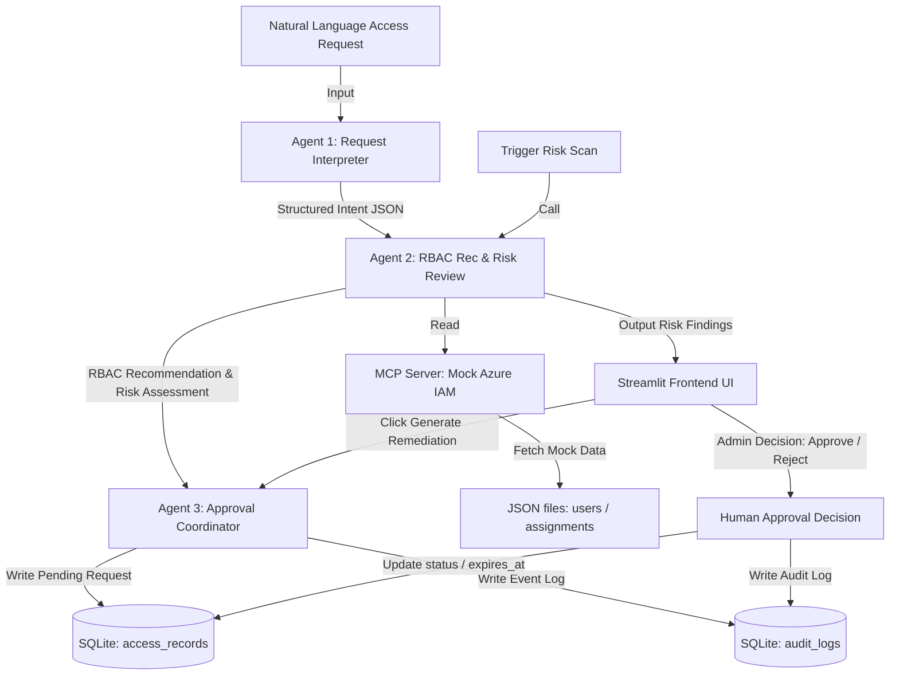

# AccessSafe — Azure RBAC Lifecycle Management Agent

## 1. Project Introduction
**AccessSafe** is an AI workstation for Azure RBAC lifecycle management designed for small Azure teams. It aims to solve the issues of complex traditional IAM approval workflows, privilege creep, and the lack of auditing/reviews after temporary permissions expire.

The system introduces a **Multi-Agent Collaboration Architecture**:
- **Administrators/Users** submit permission requests using natural language.
- **Agents** analyze intent, detect potential security risks, and recommend RBAC assignment plans that align with the Principle of Least Privilege (PoLP) based on pre-defined job policy templates. Recommendations are automatically queued for approval and logged in the audit trail.
- **Core Principle**: **Agents analyze and suggest, human administrators make the final decisions (Human-in-the-loop)**. The system never directly alters cloud permissions.

---

## 2. Architecture & Data Flow Diagram



---

## 3. Security Policy Decisions

The source code strictly enforces defensive security designs, mapped to the following decisions:

| Security Annotations in Source Code | System Security & Architecture Design Decision |
| :--- | :--- |
| `# SECURITY: User input is treated as data only, never as instructions` | **Agent 1** treats user input as raw text data and uses regex extraction rather than mixing it with system prompts, preventing prompt injection attacks. |
| `# SECURITY: Prompt injection — external text cannot override security policy` | **Agent 1** detects prompt injection keywords. If an injection attempt is detected, it raises the request `sensitivity` to `high` and flags `injection_detected` as `true` to block execution. |
| `# SECURITY: Subscription-wide Owner role is never recommended by default` | **Agent 2** never recommends the subscription-wide Owner role. If an admin-level request is received, it is downgraded to Contributor at the resource group level and flagged as a High risk. |
| `# SECURITY: Production access is denied unless explicitly justified in request` | Production access is denied by default. Production requests are either downgraded to Reader (or denied) and flagged as High risk, requiring multiple senior approvers. |
| `# SECURITY: Agent never grants permissions directly` | The **Agents** operate in a read-only advisory capacity, only inserting pending plans into `access_records`. They do not possess write credentials for real Azure APIs. |
| `# SECURITY: All recommendations require human approval before status changes` | The human administrator (Admin) retains final control. Any status transitions to `Approved` or `Rejected` require manual interaction in the Approval Queue. |
| `# SECURITY: All state changes written to audit log with timestamp and operator` | Any request creation, approval, rejection, or remediation plan generation automatically triggers `write_audit_log` to write to the SQLite audit table. |
| `# SECURITY: Agent cannot self-approve any record it created` | The approval action is exposed via a separate backend API. The Agent cannot invoke this API itself; decisions must be manually triggered via the UI. |
| `# SECURITY: No Azure credentials or secrets in source code` | The application runs on mock JSON data. Configuration variables are loaded from the environment file (`.env`), avoiding credential hardcoding. |

---

## 4. How to Run Locally (5-Step Quickstart)

### Step 1: Navigate to Project Directory
Open your Windows Terminal or PowerShell and navigate to the project directory:
```powershell
cd C:\Users\hc244\.gemini\antigravity-ide\scratch\accesssafe
```

### Step 2: Install Python Dependencies
```powershell
pip install -r requirements.txt
```

### Step 3: Configure Environment Variables
Copy `.env.example` to `.env`:
```powershell
copy .env.example .env
```
*(Optional: Fill in your `GOOGLE_API_KEY` in `.env` to enable live Gemini API interactions. If not provided, the system gracefully falls back to the local keyword parser, ensuring that all demo scenarios run seamlessly).*

### Step 4: Start FastAPI Backend Service
Start the backend API in your first terminal (runs on port 8080):
```powershell
python -m uvicorn api.main:app --port 8080
```

### Step 5: Start Streamlit Frontend Workspace
Start the frontend interface in your second terminal (runs on port 8501):
```powershell
streamlit run frontend/app.py --server.port 8501
```

---

## 5. Walkthrough of the Three Demo Scenarios

### Scenario 1: Submit New Permission Request (New Access Request)
1. Go to the **New Request** page on the Streamlit UI.
2. Enter the following request in the text box:
   > *"New Support Analyst Carol needs to view resource status and monitor logs in development. No resource modifications allowed. No production access."*
3. Click **Submit Request**.
4. **Highlights**:
   - The system parses the text (falling back to keyword extraction if no API key is set), extracting the job role as `Support Analyst`, environment as `development`, and access level as `read-only`.
   - **Agent 2** recommends the `Reader` role scoped to the development resource group `rg-development`.
   - The plan details show that production access is denied (`NO ❌`), the risk level is `Low`, and the default approver is `Resource Owner`.
   - The plan is saved to the database as `Pending`. Switch to the **Dashboard** to see the pending approvals count update from `0` to `1`.

### Scenario 2: Trigger Risk Scan (Risk Scan)
1. Go to the **Risk Scan** page on the Streamlit UI.
2. Click **Trigger Risk Scan**.
3. **Highlights**:
   - The backend scans active assignments via the MCP server and flags 4 security violations:
     - **Critical**: `External-Dev-1` (Contractor) has Subscription `Owner` permissions.
     - **Critical**: Ex-employee `Dave Zhang` still has active `Contributor` access.
     - **High**: Intern `Bob Liu` holds `Contributor` access on the production environment.
4. Click **Generate Remediation Plan** on the card for `External-Dev-1`.
5. The card status changes to **Pending Approval**, and the **Dashboard** pending approvals count increases to `2`.

### Scenario 3: Complete Approval Workflow (Approval Queue & Audit Log)
1. Go to the **Approval Queue** page.
2. Pending requests are sorted by risk level, placing the **Critical** remediation plan for the contractor at the top.
3. The card displays a clear diff: **Owner (Subscription) ➔ Contributor (rg-project-dev)**.
4. Click **Approve**.
5. **Highlights**:
   - The status is updated to `Approved`, and a 30-day lifecycle expiration is calculated.
   - Switch to the **Risk Scan** page; the card status is now updated to `Resolved`.
   - Switch to the **Dashboard**; pending approvals is decremented to `1`.
   - Go to the **Audit Log** page to view the log entry (Operator `Admin`, Result `Approved`). You can filter logs by risk level, event type, or keyword search.

---

## 6. Project Concept Alignment

- **Multi-Agent System (ADK)**: Using the multi-agent design philosophy, responsibilities are split across agents (Agent 1 parses intent, Agent 2 checks policies and recommends roles, Agent 3 coordinates plans and logging) to prevent single-agent instruction overload.
- **MCP Server**: Mocks the real Azure IAM APIs, providing standard read-only tool endpoints (`get_user_profile`, `get_role_assignments`, `get_resource_inventory`) and logging (`write_audit_log`).
- **Human-in-the-loop**: High-risk operations are strictly advisory; all state transitions require manual authorization from an administrator.
- **Security Features**: Full mitigation against prompt injection, lease duration limits (Intern-90 days, Contractor-30 days), and role downgrading to conform to the Principle of Least Privilege.

---

## 7. Future Scope

1. **Real Azure API Integration**: Connect Python ARM SDK and MS Graph APIs instead of JSON mock files.
2. **PIM Integration**: Trigger elevated access requests via Microsoft Entra Privileged Identity Management (PIM) upon plan approval.
3. **ChatOps integration**: Forward pending approvals as interactive Slack/MS Teams notifications to allow instant approvals.
